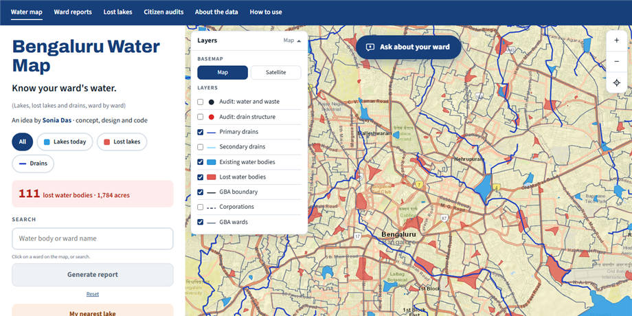

# Bengaluru Water Map: Know Your Ward's Water

## Overview

From March 2025 to February 2026 I worked with MOD Foundation on Building a Resilient
Bengaluru. Volunteer teams walked the city's stormwater drains and recorded what they found
at each point: the water colour, the smell, any garbage, unauthorised inlets, broken
retaining walls. By the end there was a large, careful dataset.

In May 2026 I went to a DataJam, and one thought stayed with me afterwards: if I were
building something from this data for residents, what would it be? This map is my answer so
far. It reflects my own understanding of what residents need, and it is a work in progress.

- **Role:** Concept, design and code
- **Data:** Building a Resilient Bengaluru (MOD Foundation), accessed 23 May 2026
- **Study Area:** Bengaluru, India

---

## What It Does

- **Shows the city's water on one map.** Existing lakes, lost lakes, primary and secondary
  drains, and ward and corporation boundaries are separate layers you can switch on and off.
- **Ask about your ward.** Type a ward name or a lake near you and ask a plain question, like
  "Has Mylasandra lost any lakes?" or "What did audits find?" The answers come from the map's
  own data, not from AI.
- **Gives every ward a full report.** Each report covers its water bodies, the drains that
  cross it (with the length inside the ward), what citizen audits found and what each finding
  usually means, and next steps for residents and officials. It ends with a numbered list of
  sites that need follow-up, each linked to its exact spot in Google Maps.
- **Lets you report on your own area.** Upload a KML polygon of your neighbourhood or project
  site and get the same report for that area. The file is read in your browser and never
  uploaded.
- **Saves as a PDF**, so you can share it with your ward office, ward committee or residents'
  group.

---

## About the Data

- Source: Building a Resilient Bengaluru, data accessed on 23 May 2026. Water body, drain and
  ward data by MOD Foundation. Basemap tiles © Esri.
- The year shown for a lost lake is the last survey it appears in. It is not the year the lake
  was lost.
- Audit points are visual checks by trained volunteers, not lab tests. They show where to look
  more closely. Water quality can only be confirmed by testing, for example by the Karnataka
  State Pollution Control Board.
- Some numbers are clipped to the boundary. Drain lengths and lake areas count only the part
  inside the ward or area. Drains with less than 20 m inside, and lake pieces under 0.1 acres,
  are left out.

---

## What's Next

I'd like people to be able to talk to this map one day. A voice layer would let a resident ask
about their ward out loud instead of typing. That matters in a city where many people are more
comfortable speaking than typing, and in more than one language.

---

## Tools Used

| Tool | Purpose |
|------|---------|
| Python / GeoPandas | Cleaning and simplifying the water body, drain and ward layers |
| Leaflet | Interactive web map |
| KoboToolbox | Citizen audit data from the stormwater drain walks |
| Esri | Basemap tiles |

---

## Links

[View Map](https://soniadas123.github.io/bengaluru-water-map/version4/){ .md-button .md-button--primary }
